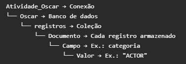

<h1 align="center">Oscar - Exercícios MongoDB</h1>

Repositório desenvolvido para praticar **MongoDB** utilizando uma base de dados histórica da premiação do Oscar.

Os exercícios exploram o **CRUD (criar, consultar, atualizar e excluir dados)**, além de filtros, organização e análise das informações armazenadas no banco de dados.

<br>

<h1 align="center">Entendendo a Lógica do MongoDB</h1>

<br><br>

<div style="display: flex; justify-content: space-between; align-items: flex-start;">
  
  
</div>

<br><br>

<h2 align="center">A estrutura de Comando no Mongosh (PowerShell do Mongo)</h2>

```javascript

db.registros.find("categoria");

db: banco Selecionado.
registros: Coleção.
FIND: Método, operação que você quer executar.
CATEGORIA: Argumentos, informações que o método precisa, como um filtro.

Ou seja db(database) + registros(coleção) + find(método) + "categoria"(argumentos). 
```

<br>

<h2 align="center"> ### Parênteses `()` e chaves `{}` </h2>

```javascript
- Parênteses `()`: recebem os argumentos do método.
- Chaves `{}`: definem um objeto/conjunto, usado nestes exemplos para representar um filtro com campo e valor.

// "categoria" é um argumento de texto: indica o campo.
db.registros.distinct("categoria");

// O argumento é um objeto de filtro: indica o campo e o valor procurado.
db.registros.find({ categoria: "ACTOR" });

// Já um objeto de filtro vazio não impõe condições: busca todos os documentos.
db.registros.find({});
```

<br>

<div align="center" style="padding: 10px; border: 1 px solid #555; border-radius:8px; background-color: #161b22;">

<center>
<table>
  <thead>
    <tr>
      <th>Operação</th>
      <th>Significado</th>
      <th>Um documento</th>
      <th>Vários documentos</th>
    </tr>
  </thead>
  <tbody>
    <tr>
      <td><strong>Create — Criar</strong></td>
      <td>Adicionar documentos</td>
      <td><code>insertOne()</code></td>
      <td><code>insertMany()</code></td>
    </tr>
    <tr>
      <td><strong>Read — Ler</strong></td>
      <td>Consultar documentos</td>
      <td><code>findOne()</code></td>
      <td><code>find()</code></td>
    </tr>
    <tr>
      <td><strong>Update — Atualizar</strong></td>
      <td>Alterar documentos</td>
      <td><code>updateOne()</code></td>
      <td><code>updateMany()</code></td>
    </tr>
    <tr>
      <td><strong>Delete — Excluir</strong></td>
      <td>Excluir documentos</td>
      <td><code>deleteOne()</code></td>
      <td><code>deleteMany()</code></td>
    </tr>
  </tbody>
</table>
</center>
</div>

<br><br>

<h1 align="center">Respostas dos Exercícios</h1>

<br>

## 1.1 Quantos Registros existem na coleção de indicados ao Oscar?

```javascript
db.registros.countDocuments();
// Conta quantos documentos tem na coleção<h4>

R: 10889 registros 
```

## 1.2 Quais são as diferentes categorias de premiação que existem no banco de dados? Liste todas as categorias únicas.

```javascript
db.oscar_indicados.distinct("categoria"); 
// Esse comando revela os valores existentes do campo. Ex : categoria: "ACTOR"

db.oscar_indicados.distinct("categoria").length; 
// Esse comando conta os valores existentes do campo. Ex : categoria: "ACTOR"; categoria: "ACTRESS" Sendo assim são = 2 

R: 115
```


## 1.3 Qual foi o primeiro ano de cerimônia do Oscar registrado na base?

<br>

```javascript
db.registros.find({}, { ano_cerimonia: 1, _id: 0 }).sort({ ano_cerimonia: 1 }).limit(1);
// Este comando mostra o menor ano de cerimônia registrado na coleção.

```
### Explicação de cada parte

- **`db`**: representa o banco de dados selecionado.
- **`registros`**: nome da coleção.
- **`find()`**: método usado para buscar documentos.
- **`{}`**: nenhuma condição foi definida, então todos os documentos são considerados.
- **A vírgula entre os dois conjuntos de chaves** separa os argumentos: o primeiro define quais documentos buscar; o segundo define quais campos mostrar.
- **`{ ano_cerimonia: 1, _id: 0 }`**: escolhe os campos que aparecem no resultado:
  - **`ano_cerimonia: 1`**: mostra o campo ano_cerimonia. Aqui, `1` não significa “primeiro ano”.
  - **`_id: 0`**: esconde somente o campo _id, que identifica o documento. Ele normalmente aparece automaticamente.
  - Os demais campos ficam de fora porque escolhemos mostrar apenas ano_cerimonia.
- **`sort({ ano_cerimonia: 1 })`**: método que ordena os resultados pelo ano, do menor para o maior. Aqui, `1` significa ordem crescente, não verdadeiro. Para ordenar do maior para o menor, usamos `-1`.
- **`limit(1)`**: método que mostra somente o primeiro documento do resultado. Como os anos estão em ordem crescente, esse documento terá o menor ano.
<br>

```javascript
db.registros.find({},{ ano_cerimonia: 1, _id: 0 }).sort({ ano_cerimonia: 1 }).limit(1);

/* A lógica é:
- find({}, ...): consulta os documentos sem aplicar filtro.
- { ano_cerimonia: 1, _id: 0 }: mostra apenas ano_cerimonia e oculta _id.
- sort({ ano_cerimonia: 1 }): ordena os anos do menor para o maior.
- limit(1): mostra apenas o primeiro resultado.*/

R:1928
```

## 1.4 Qual foi o último ano de cerimônia registrado na base?

```javascript
db.registros.distinct("ano_cerimonia");
// Através desse comando da para checkar manualmente em toda a lista

db.registros.find({}, { ano_cerimonia: 1, _id: 0 }).sort({ ano_cerimonia: -1 }).limit(1); 
// Já esse comando faz com que aparece o valor específico do campo.

R: 2026
```

## 1.5 Quantas cerimônias do Oscar estão registradas no total?

```javascript
db.registros.distinct("cerimonia").length;
// Conta quantas cerimônias diferentes existem na coleção, sem repetir.

R: 98
```

## 1.6 Atualize os registros da coleção com os dados do Oscar 2025 e 2026 (pesquise os indicados e adicione-os).

```javascript

db.registros.insertMany + os dados;
// Este comando adiciona um ou mais documentos à coleção do banco de dados.

R: Filmes Escolhidos Marty Supreme e The Substance
```
<br>
<h1 align="center"> Nível 2: Explorando Categorias </h1>

## 2.1 Quantas indicações existem para cada categoria? Agrupe por categoria e ordene da mais frequente para a menos frequente.

```javascript
db.registros.aggregate([{ $group: { _id: "$categoria", total: { $sum: 1 } } }, { $sort: { total: -1 } }]);

// Este comando conta as indicações de cada categoria e apresenta os totais em ordem decrescente, da categoria com mais indicações para a com menos.

R:

```

## 2.2 Qual categoria teve mais indicações ao longo da história do Oscar?

```javascript

db.registros.aggregate([{ $group: { _id: "$categoria", total: { $sum: 1 } } }, { $sort: { total: -1 } }, { $limit: 1 }]);
// Este comando conta as indicações de cada categoria, ordena os totais do maior para o menor e mostra apenas a categoria com mais indicações.

R:  _id: 'DIRECTING',
  total: 469
```

## 2.3 Qual categoria teve menos indicações ao longo da história?

```javascript

db.registros.aggregate([{ $group: { _id: "$categoria", total: { $sum: 1 } } }, { $sort: { total: 1 } }, { $limit: 1 }]);
// Este comando conta as indicações de cada categoria, ordena os totais do menor para o maior e mostra uma das categorias com menos indicações.

```

## 2.4 A partir de que ano a categoria "ACTRESS" deixou de existir? (Dica: procure a última cerimônia com essa categoria)

```javascript

db.registros.find({ categoria: "ACTRESS" }, { ano_cerimonia: 1, _id: 0 }).sort({ ano_cerimonia: -1 }).limit(1);
// Este comando busca a última cerimônia registrada com a categoria "ACTRESS", mostrando apenas o ano.

```

## 2.5 Quais categorias existiam na primeira cerimônia (1928) e não existem mais hoje?

```javascript

db.registros.aggregate([{ $group: { _id: "$categoria", anos: { $addToSet: "$ano_cerimonia" } } }, { $match: { anos: { $all: [1928], $nin: [2024] } } }, { $sort: { _id: 1 } }]);
// Este comando lista as categorias que aparecem em 1928, mas não aparecem em 2024.

```

## 2.6 Liste todas as categorias que contêm a palavra "DIRECTING" no nome.

```javascript
db.registros.distinct("categoria", { categoria: /DIRECTING/ });
// Este comando lista, sem repetição, as categorias que contêm a palavra DIRECTING no nome.
```
<br>
<h1 align="center">Nível 3: Atores e Atrizes Famosos</h1>
<h2 align="center">Natalie Portman</h2>


## 3.1 Quantas vezes Natalie Portman foi indicada ao Oscar?

```javascript
db.registros.countDocuments({ nome_do_indicado: "Natalie Portman" });
// Este comando conta quantas indicações de Natalie Portman estão registradas na coleção.

R: 3 indicações.
```

## 3.2 Quantos Oscars Natalie Portman ganhou?

```javascript
db.registros.countDocuments({ nome_do_indicado: "Natalie Portman", vencedor: 1 });
// Este comando conta quantas indicações de Natalie Portman estão registradas como vencedoras.

R: 1 Oscar.
```

## 3.3 Em quais anos e por quais filmes Natalie Portman foi indicada?

```javascript
db.registros.find({ nome_do_indicado: "Natalie Portman" }, { ano_cerimonia: 1, nome_do_filme: 1, _id: 0 }).sort({ ano_cerimonia: 1 });
// Este comando mostra os anos e os filmes das indicações de Natalie Portman, do ano mais antigo para o mais recente.

R: 2005 — Closer; 2011 — Black Swan; 2017 — Jackie.
```

## 3.4 Liste todas as indicações de Natalie Portman mostrando: ano, categoria, filme e se venceu.

```javascript
db.registros.find({ nome_do_indicado: "Natalie Portman" }, { ano_cerimonia: 1, categoria: 1, nome_do_filme: 1, vencedor: 1, _id: 0 }).sort({ ano_cerimonia: 1 });
// Este comando lista as indicações de Natalie Portman, mostrando ano, categoria, filme e resultado, do ano mais antigo para o mais recente.

R: 2005 — ACTRESS IN A SUPPORTING ROLE — Closer — não venceu
2011 — ACTRESS IN A LEADING ROLE — Black Swan — venceu
2017 — ACTRESS IN A LEADING ROLE — Jackie — não venceu
```
<br>
<h2 align="center">Viola Davis</h2>

## 3.5 Quantas vezes Viola Davis foi indicada ao Oscar?

```javascript
db.registros.countDocuments({ nome_do_indicado: "Viola Davis" });
// Este comando conta quantas indicações de Viola Davis estão registradas na coleção.

R: 4 indicações.
```

## 3.6 Quantos Oscars Viola Davis ganhou?

```javascript
db.registros.countDocuments({ nome_do_indicado: "Viola Davis", vencedor: 1 });
// Este comando conta quantas indicações de Viola Davis estão registradas como vencedoras.

R: 1 Oscar.
```

## 3.7 Por quais filmes Viola Davis foi indicada?

```javascript
db.registros.find({nome_do_indicado:"Viola Davis"});
// Este comando mostra todos os documentos de indicações de Viola Davis.

ou

db.registros.distinct("nome_do_filme", { nome_do_indicado: "Viola Davis" });
// Este comando lista, sem repetição, os filmes pelos quais Viola Davis foi indicada ao Oscar.

R: 1 Oscar.
```
<br>
<h2 align="center">Amy Adams</h2>


## 3.8 Amy Adams já ganhou algum Oscar?

```javascript
db.registros.countDocuments({ nome_do_indicado: "Amy Adams", vencedor: 1 });
// Este comando conta quantas vitórias de Amy Adams estão registradas na coleção.

R: Não. Nenhuma vitória registrada.
```

## 3.9 Quantas vezes Amy Adams foi indicada sem ganhar?

```javascript
db.registros.countDocuments({ nome_do_indicado: "Amy Adams", vencedor: 0 });
// Este comando conta quantas indicações de Amy Adams estão registradas como derrotas.

R: 6 indicações sem ganhar.
```
<br>
<h2 align="center">Denzel Washington</h2>

## 3.10 Denzel Washington já ganhou algum Oscar?

```javascript
db.registros.countDocuments({ nome_do_indicado: "Denzel Washington", vencedor: 1 });
// Este comando conta quantas vitórias de Denzel Washington estão registradas na coleção.

R: Sim, 2 vitórias registradas.
```

## 3.11 Quantas vezes Denzel Washington foi indicado ao Oscar?

```javascript
db.registros.countDocuments({ nome_do_indicado: "Denzel Washington" });
// Este comando conta quantas indicações de Denzel Washington estão registradas na coleção.

R: 9 indicações.
```

## 3.12 Liste todos os Oscars que Denzel Washington ganhou (ano, categoria, filme).

```javascript
db.registros.find({ nome_do_indicado: "Denzel Washington", vencedor: 1 }, { ano_cerimonia: 1, categoria: 1, nome_do_filme: 1, _id: 0 }).sort({ ano_cerimonia: 1 });
// Este comando lista as vitórias de Denzel Washington, mostrando o ano, a categoria e o filme, do ano mais antigo para o mais recente.

R: 1990 — ACTOR IN A SUPPORTING ROLE — Glory
2002 — ACTOR IN A LEADING ROLE — Training Day
```

<br>
<h1 align="center">Nível 4: Vencedores Históricos</h1>

## 4.1 Quem ganhou o primeiro Oscar para Melhor Atriz (ACTRESS)? Em que ano e por qual filme?

```javascript
db.registros.find({ categoria: "ACTRESS", vencedor: 1 }, { nome_do_indicado: 1, ano_cerimonia: 1, nome_do_filme: 1, _id: 0 }).sort({ ano_cerimonia: 1 }).limit(1);
// Este comando mostra a primeira vencedora registrada na categoria ACTRESS, incluindo seu nome, o ano da cerimônia e o filme.

R: Janet Gaynor — 1928 — 7th Heaven
```

## 4.2 Quem ganhou o primeiro Oscar para Melhor Ator (ACTOR)? Em que ano e por qual filme?

```javascript
db.registros.find({ categoria: "ACTOR", vencedor: 1 }, { nome_do_indicado: 1, ano_cerimonia: 1, nome_do_filme: 1, _id: 0 }).sort({ ano_cerimonia: 1 }).limit(1);
// Este comando mostra o primeiro vencedor registrado na categoria ACTOR, incluindo seu nome, o ano da cerimônia e o filme.

R: Emil Jannings — 1928 — The Last Command
```

## 4.3 Quantos vencedores existem ao todo na base de dados?

```javascript
db.registros.countDocuments({ vencedor: 1 });
// Este comando conta todos os documentos registrados como vencedores na coleção.

R: 2.464 documentos vencedores.
```

## 4.4 Liste todos os filmes que ganharam o Oscar de Melhor Filme (categoria "OUTSTANDING PICTURE" ou "BEST PICTURE").

```javascript
db.registros.find({ categoria: { $in: ["OUTSTANDING PICTURE", "BEST PICTURE"] }, vencedor: 1 }, { nome_do_filme: 1, ano_cerimonia: 1, _id: 0 }).sort({ ano_cerimonia: 1 });
// Este comando lista os filmes vencedores nas categorias OUTSTANDING PICTURE ou BEST PICTURE, mostrando o filme e o ano da cerimônia.

R: 2.464 documentos vencedores.
```

## 4.5 Quantos filmes diferentes já ganharam o Oscar?

```javascript
db.registros.distinct("nome_do_filme", { vencedor: 1, nome_do_filme: { $nin: [null, "NULL", ""] } }).length;
// Este comando conta os títulos diferentes de filmes vencedores, sem repetir e desconsiderando valores vazios, null e o texto "NULL".

R: 1.328 títulos diferentes de filmes vencedores. Títulos iguais são contados uma única vez.
```

<br>
<h1 align="center">Nível 5: Análise de Indicações</h1>

## 5.1 Quais atores/atrizes foram indicados mais de uma vez? Liste o nome e o número de indicações.

```javascript
db.registros.aggregate([{ $match: { categoria: /^(ACTOR|ACTRESS)/ } }, { $group: { _id: "$nome_do_indicado", indicacoes: { $sum: 1 } } }, { $match: { indicacoes: { $gt: 1 } } }, { $sort: { indicacoes: -1, _id: 1 } }]);
// Este comando conta as indicações de cada ator ou atriz e lista quem possui mais de uma, mostrando o nome e a quantidade.

R: 362 nomes
```

## 5.2 Qual ator ou atriz tem o maior número de indicações na história do Oscar?

```javascript
db.registros.aggregate([{ $match: { categoria: /^(ACTOR|ACTRESS)/ } }, { $group: { _id: "$nome_do_indicado", indicacoes: { $sum: 1 } } }, { $sort: { indicacoes: -1, _id: 1 } }, { $limit: 1 }]);
// Este comando conta as indicações em atuação e mostra o ator ou a atriz com o maior total; em caso de empate, apresenta um dos nomes.

R: Meryl Streep: 21 indicações em atuação (3 vitórias).
```

## 5.3 Quais atores foram indicados mais de 3 vezes, mas nunca ganharam?

```javascript
db.registros.aggregate([{ $match: { categoria: /^(ACTOR|ACTRESS)/ } }, { $group: { _id: "$nome_do_indicado", indicacoes: { $sum: 1 }, vitorias: { $sum: { $cond: [{ $in: ["$vencedor", [1, true, "1", "true"]] }, 1, 0] } } } }, { $match: { indicacoes: { $gt: 3 }, vitorias: 0 } }, { $sort: { indicacoes: -1, _id: 1 } }]);
// Este comando lista atores e atrizes com mais de três indicações e nenhuma vitória nas categorias de atuação.

R: 26 nomes
```

## 5.4 Encontre todos os artistas que foram indicados em categorias diferentes (ex: ator e diretor).

```javascript
db.registros.aggregate([{ $match: { nome_do_indicado: { $type: "string", $nin: ["", "NULL"] } } }, { $group: { _id: "$nome_do_indicado", categorias: { $addToSet: "$categoria" } } }, { $match: { "categorias.1": { $exists: true } } }, { $sort: { _id: 1 } }]);
// Este comando lista os nomes que aparecem em pelo menos duas categorias diferentes, mostrando as categorias de cada um.

R: 633 nomes
```

## 5.5 Quantos indicados têm exatamente 1 indicação na história?

```javascript
db.registros.aggregate([{ $match: { nome_do_indicado: { $type: "string", $nin: ["", "NULL"] } } }, { $group: { _id: "$nome_do_indicado", indicacoes: { $sum: 1 } } }, { $match: { indicacoes: 1 } }, { $count: "total_indicados" }]);
// Este comando conta quantos nomes possuem exatamente uma indicação registrada na coleção.

R: 5.591 nomes com exatamente uma indicação.
```

## 5.6 Qual o maior números de indicados em um único ano? Essa é uma pergunta franca.

```javascript
db.registros.aggregate([{ $group: { _id: "$ano_cerimonia", indicacoes: { $sum: 1 } } }, { $sort: { indicacoes: -1, _id: 1 } }, { $limit: 1 }]);
// Este comando mostra o ano com o maior número de indicações registradas e o total correspondente.

R: 186 indicações em 1943. O critério do comando conta documentos, não pessoas diferentes.
```

<br>
<h1 align="center">Nível 6: Análise de Filmes</h1>

<br>
<h2 align="center">Toy Story</h2>

## 6.1 A série de filmes Toy Story ganhou Oscars em quais anos?

```javascript
db.registros.distinct("ano_cerimonia", { nome_do_filme: /^Toy Story(?: \d+)?$/, vencedor: 1 });
// Este comando lista, sem repetição, os anos em que os filmes da série Toy Story possuem vitórias registradas.

R: 2011; 2020.
```

## 6.2 Quantas indicações a franquia Toy Story recebeu no total?

```javascript
db.registros.countDocuments({ nome_do_filme: /^Toy Story(?: \d+)?$/ });
// Este comando conta as indicações registradas para Toy Story e suas continuações numeradas.

R: 11 indicações.
```

## 6.3 Em quais categorias os filmes Toy Story foram indicados?

```javascript
db.registros.aggregate([{ $match: { nome_do_filme: /^Toy Story(?: \d+)?$/ } }, { $group: { _id: "$nome_do_filme", categorias: { $addToSet: "$categoria" } } }, { $sort: { _id: 1 } }]);
// Este comando mostra cada filme da série Toy Story e as categorias em que foi indicado, sem repetir categorias.
```

<br>
<h2 align="center">Crash</h2>

## 6.4 Em qual edição do Oscar o filme "Crash" concorreu?

```javascript
db.registros.aggregate([{ $match: { nome_do_filme: "Crash" } }, { $group: { _id: { cerimonia: "$cerimonia", ano: "$ano_cerimonia" } } }, { $sort: { "_id.ano": 1 } }]);
// Este comando mostra as edições e os anos das cerimônias em que o filme Crash possui indicações registradas.

R: 78ª cerimônia, em 2006.
```

## 6.5 Quantas indicações o filme "Crash" recebeu?

```javascript
db.registros.countDocuments({ nome_do_filme: "Crash" });
// Este comando conta quantas indicações do filme Crash estão registradas na coleção.

R: 6 indicações.
```

## 6.6 "Crash" ganhou o Oscar de Melhor Filme?

```javascript
db.registros.countDocuments({ nome_do_filme: "Crash", categoria: "BEST PICTURE", vencedor: 1 });
// Este comando conta as vitórias de Crash na categoria Melhor Filme; um resultado maior que zero indica que ele venceu.

R: Sim, vencedor de BEST PICTURE.
```

<br>
<h2 align="center">Central do Brasil</h2>

## 6.7 O filme "Central do Brasil" aparece no banco de dados?

```javascript
db.registros.find({ nome_do_filme: { $in: ["Central do Brasil", "Central Station"] } });
// Este comando busca os documentos de Central do Brasil, considerando também o título em inglês Central Station.

R: Sim, registrado como Central Station.
```

## 6.8 Se sim, quantas indicações "Central do Brasil" recebeu?

```javascript
db.registros.countDocuments({ nome_do_filme: { $in: ["Central do Brasil", "Central Station"] } });
// Este comando conta as indicações registradas para Central do Brasil ou Central Station.

R: 2 indicações.
```

<br>
<h1 align="center">Nível 7: Operações de Atualização</h1>

## 7.1 No campo "vencedor", altere todos os valores "true" (string) para true (booleano) e "false" (string) para false (booleano).

```javascript
db.registros.updateMany({ vencedor: "true" }, { $set: { vencedor: true } });
// Este comando substitui o texto "true" pelo valor booleano true no campo vencedor.

db.registros.updateMany({ vencedor: "false" }, { $set: { vencedor: false } });
// Este comando substitui o texto "false" pelo valor booleano false no campo vencedor.

```


## 7.2 Inclua no banco 3 filmes que nunca foram nomeados ao Oscar, mas que você acha que merecem. Use dados fictícios mas realistas.

```javascript
db.registros.insertMany([{ ano_filmagem: 2023, ano_cerimonia: 2024, cerimonia: 96, categoria: "INDICACAO FICTICIA", nome_do_indicado: "Marina Duarte", nome_do_filme: "A Última Estação de Aurora", diretor: "Marina Duarte", vencedor: 0, ficticio: true }, { ano_filmagem: 2023, ano_cerimonia: 2024, cerimonia: 96, categoria: "INDICACAO FICTICIA", nome_do_indicado: "Rafael Monteiro", nome_do_filme: "Cartas para um Amanhã Distante", diretor: "Rafael Monteiro", vencedor: 0, ficticio: true }, { ano_filmagem: 2023, ano_cerimonia: 2024, cerimonia: 96, categoria: "INDICACAO FICTICIA", nome_do_indicado: "Clara Azevedo", nome_do_filme: "O Silêncio das Marés de Inverno", diretor: "Clara Azevedo", vencedor: 0, ficticio: true }]);

// Este comando adiciona três documentos fictícios à coleção e os identifica com o campo ficticio.

R: Os três filmes fictícios preparados no comando não estão na coleção exportada. A inserção permanece pendente; não executei comandos de escrita.
```

## 7.3 Adicione uma nova categoria chamada "BEST INTERNATIONAL FEATURE FILM" com alguns vencedores recentes (2020-2024).

```javascript
db.registros.insertMany([{ ano_filmagem: 2019, ano_cerimonia: 2020, cerimonia: 92, categoria: "BEST INTERNATIONAL FEATURE FILM", nome_do_indicado: "South Korea", nome_do_filme: "Parasite", diretor: "Bong Joon Ho", vencedor: 1 }, { ano_filmagem: 2021, ano_cerimonia: 2022, cerimonia: 94, categoria: "BEST INTERNATIONAL FEATURE FILM", nome_do_indicado: "Japan", nome_do_filme: "Drive My Car", diretor: "Ryusuke Hamaguchi", vencedor: 1 }, { ano_filmagem: 2023, ano_cerimonia: 2024, cerimonia: 96, categoria: "BEST INTERNATIONAL FEATURE FILM", nome_do_indicado: "United Kingdom", nome_do_filme: "The Zone of Interest", diretor: "Jonathan Glazer", vencedor: 1 }]);

// Este comando adiciona três vencedores internacionais com o nome de categoria solicitado no exercício.

```

## 7.4 Corrija possíveis erros de digitação nos nomes dos filmes (ex: espaços extras, caracteres especiais desnecessários).

```javascript
db.registros.updateMany({ nome_do_filme: { $type: "string", $regex: /(^\s|\s$|\s{2,})/ } }, [{ $set: { nome_do_filme: { $reduce: { input: { $regexFindAll: { input: "$nome_do_filme", regex: /\S+/ } }, initialValue: "", in: { $concat: ["$$value", { $cond: [{ $eq: ["$$value", ""] }, "", " "] }, "$$this.match"] } } } } }]);

// Este comando remove espaços nas extremidades dos títulos e transforma sequências de espaços em branco em um único espaço.
```

## 7.5 Remova todos os registros com valor NULL no campo nome_do_filme.

```javascript
db.registros.find({ $or: [{ nome_do_filme: { $type: 10 } }, { nome_do_filme: "NULL" }] });

// Este comando mostra os documentos cujo nome_do_filme contém null ou o texto "NULL".
```
