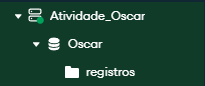
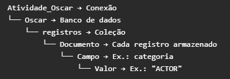

<h1 align="center">Entendendo a Lógica do MongoDB</h1>

<div style="display: flex; justify-content: space-between; align-items: flex-start;">
  
  
</div>

<br><br>

<h2 align="center">A estrutura de Comando no Mongosh (PowerShell do Mongo)</h2>

```javascript
db.registros.distinct("categoria");

db: banco selecionado.
registros: coleção.
Método: operação que você quer executar.
Argumentos: informações que o método precisa, como um filtro.

Ou seja db(database) + registros(coleção) + distinct(método) + "categoria"(argumentos). 
```
<br></br>
<div align="center"; "style="padding: 10px; border: 1 px solid #555; border-radius:8px; background-color: #161b22;">

<table>
  <thead>
    <tr>
      <th>Operação</th>
      <th>Significado</th>
      <th>Um documento</th>
      <th>Vários documentos</th>
    </tr>
  </thead>
  <tbody>
    <tr>
      <td><strong>Create — Criar</strong></td>
      <td>Adicionar documentos</td>
      <td><code>insertOne()</code></td>
      <td><code>insertMany()</code></td>
    </tr>
    <tr>
      <td><strong>Read — Ler</strong></td>
      <td>Consultar documentos</td>
      <td><code>findOne()</code></td>
      <td><code>find()</code></td>
    </tr>
    <tr>
      <td><strong>Update — Atualizar</strong></td>
      <td>Alterar documentos</td>
      <td><code>updateOne()</code></td>
      <td><code>updateMany()</code></td>
    </tr>
    <tr>
      <td><strong>Delete — Excluir</strong></td>
      <td>Excluir documentos</td>
      <td><code>deleteOne()</code></td>
      <td><code>deleteMany()</code></td>
    </tr>
  </tbody>
</table>
</center>
</div>

<br><br>

<h1 align="center">Respostas dos Exercícios</h1>

<br>

## 1.1 Quantos Registros existem na coleção de indicados ao Oscar?

```javascript
.countDocuments();
// Conta quantos documentos tem na coleção<h4>

R: 10889 registros 
```

## 1.2 Quais são as diferentes categorias de premiação que existem no banco de dados? Liste todas as categorias únicas.

```javascript
db.oscar_indicados.distinct("categoria"); 
// Esse comando revela os valores existentes do campo. Ex : categoria: "ACTOR"

db.oscar_indicados.distinct("categoria").length; 
// Esse comando conta os valores existentes do campo. Ex : categoria: "ACTOR"; categoria: "ACTRESS" Sendo assim são = 2 

R: 115
```

